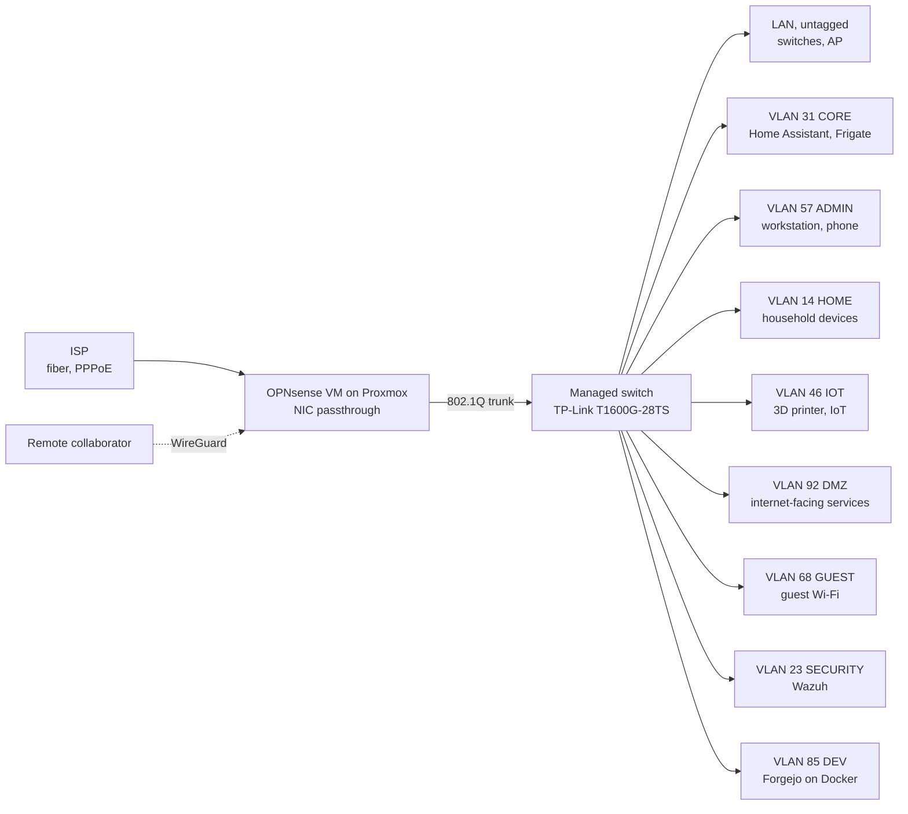

# Homelab

Documentation of a home lab used for learning Linux administration, networking and security monitoring. Everything here runs on real hardware and is documented as it is built, including what went wrong along the way.

> **Status:** work in progress. Sections marked **TODO** are still being written.

## Platform

- **Hypervisor:** Proxmox VE, 32 GB RAM
- **Firewall / router:** OPNsense as a VM, Intel NIC passed through (PCI passthrough)
- **Switching:** TP-Link T1600G-28TS + a second switch (TODO: model and role)
- **Wi-Fi:** access point that tags all client traffic into VLANs
- **Lab:** FortiGate (TODO: describe its role)
- **Admin authentication:** YubiKey 5C NFC (hardware-backed SSH key)
- **Preferred server OS:** Debian

## Network design

> **Note:** VLAN IDs in this documentation are randomized and don't match the real network.

Every network has its own /24 subnet.

| VLAN | Name | Purpose |
|------|------|---------|
| untagged | LAN | Network infrastructure only: switch and AP management, no client devices |
| 31 | CORE | Home Assistant, Frigate NVR |
| 57 | ADMIN | Admin workstation and phone only, used for managing the network |
| 14 | HOME | Everyday household devices |
| 46 | IOT | IoT devices, e.g. the 3D printer |
| 92 | DMZ | Services reachable from the internet |
| 68 | GUEST | Guest Wi-Fi |
| 23 | SECURITY | Wazuh SIEM server |
| 85 | DEV | Self-hosted dev services on Docker (Forgejo) |

TODO: summary of inter-VLAN firewall rules.

Simplified logical view:

## Security hardening

- **SSH to OPNsense:** public-key only, with the private key stored on a YubiKey. Password login is disabled.
- **Web GUI:** the OPNsense GUI listens only on the LAN and the ADMIN VLAN.
- **Segmentation:** nine networks split by role and trust level. Day-to-day management happens from the ADMIN VLAN, which holds just two devices.
- **SIEM:** Wazuh in its own SECURITY VLAN (*in progress*).
- **IDS/IPS:** Suricata (*in progress*).
- **Remote access:** a collaborator connects over WireGuard to reach the DEV VLAN. TODO: document the rules that limit this access.

## Services

| Service | Where | Status |
|---------|-------|--------|
| OPNsense | Proxmox VM | running |
| Home Assistant | CORE VLAN | running |
| Frigate NVR + go2rtc | CORE VLAN | running |
| Wazuh | SECURITY VLAN | in progress |
| Suricata | TODO | in progress |
| Forgejo | Docker, DEV VLAN | in progress |
| Minecraft server (Crafty Controller) | Debian VM | running |

## Lessons learned

- **PCI passthrough vs. snapshots:** with the NIC passed through to the OPNsense VM, Proxmox snapshots of that VM don't work. TODO: how the router config is backed up instead.
- TODO: add an entry every time something breaks and gets fixed.

## Write-ups

Planned case studies, one per week:

- [ ] OPNsense on Proxmox with NIC passthrough
- [ ] VLAN segmentation and inter-VLAN firewall rules
- [x] Hardening admin access: YubiKey-backed SSH, GUI bound to admin networks
- [ ] Wazuh SIEM in a dedicated security VLAN
- [ ] Suricata IDS/IPS
- [ ] Self-hosted Forgejo on Docker with WireGuard access
- [ ] Frigate NVR with go2rtc
- [ ] Real-world deployment: Wi-Fi and firewall for an event venue (anonymized)
- [ ] Checking OPNsense for signs of a break-in after a late patch

Each write-up follows the same format: **problem → decisions and why → key config (sanitized) → what went wrong → next steps.**

---

Built and documented by thmg.
