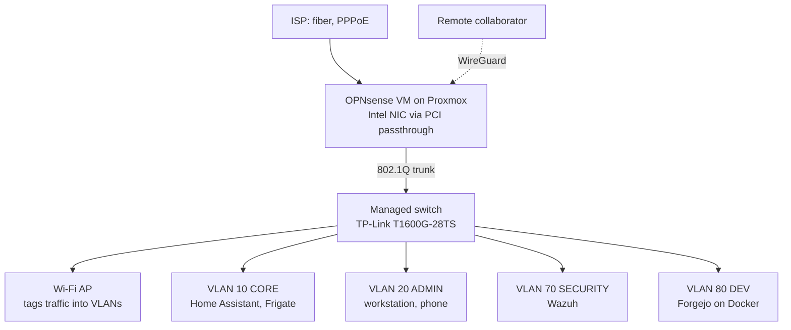

# Homelab

Documentation of a home lab used for learning Linux administration, networking and security monitoring. Everything here runs on real hardware and is documented as it is built, including what went wrong along the way.

> **Status:** work in progress. Sections marked **TODO** are still being written.

## Platform

- **Hypervisor:** Proxmox VE, 32 GB RAM
- **Firewall / router:** OPNsense as a VM, Intel NIC passed through (PCI passthrough)
- **Switching:** TP-Link T1600G-28TS + a second switch (TODO: model and role)
- **Wi-Fi:** access point that tags all client traffic into VLANs
- **Lab:** FortiGate (TODO: describe its role)
- **Admin authentication:** YubiKey 5C NFC (hardware-backed SSH key)
- **Preferred server OS:** Debian

## Network design

Each VLAN gets its own subnet: `192.168.<VLAN ID>.0/24`.

| VLAN | Name | Purpose |
|------|------|---------|
| untagged | INFRA | Switch and AP management only, no client devices |
| 10 | CORE | Home Assistant, Frigate NVR |
| 20 | ADMIN | Admin workstation and phone only, used for managing the network |
| 70 | SECURITY | Wazuh SIEM server |
| 80 | DEV | Self-hosted dev services on Docker (Forgejo) |
| TODO | IoT | 3D printer and other IoT devices |

TODO: camera network, summary of inter-VLAN firewall rules.

Simplified logical view:

## Security hardening

- **SSH to OPNsense:** public-key only, with the private key stored on a YubiKey. Password login is disabled.
- **Web GUI:** the OPNsense GUI listens only on the INFRA network and the ADMIN VLAN.
- **Segmentation:** management happens from a dedicated ADMIN VLAN with two devices; services are split by role (core, security, dev).
- **SIEM:** Wazuh in its own SECURITY VLAN (*in progress*).
- **IDS/IPS:** Suricata (*in progress*).
- **Remote access:** a collaborator connects over WireGuard to reach the DEV VLAN. TODO: document the rules that limit this access.

## Services

| Service | Where | Status |
|---------|-------|--------|
| OPNsense | Proxmox VM | running |
| Home Assistant | VLAN 10 | running |
| Frigate NVR + go2rtc | VLAN 10 | running |
| Wazuh | VLAN 70 | in progress |
| Suricata | TODO | in progress |
| Forgejo | Docker, VLAN 80 | in progress |
| Minecraft server (Crafty Controller) | Debian VM | running |

## Lessons learned

- **PCI passthrough vs. snapshots:** with the NIC passed through to the OPNsense VM, Proxmox snapshots of that VM don't work. TODO: how the router config is backed up instead.
- TODO: add an entry every time something breaks and gets fixed.

## Write-ups

Planned case studies, one per week:

- [ ] OPNsense on Proxmox with NIC passthrough
- [ ] VLAN segmentation and inter-VLAN firewall rules
- [ ] Hardening admin access: YubiKey-backed SSH, GUI bound to admin networks
- [ ] Wazuh SIEM in a dedicated security VLAN
- [ ] Suricata IDS/IPS
- [ ] Self-hosted Forgejo on Docker with WireGuard access
- [ ] Frigate NVR with go2rtc
- [ ] Real-world deployment: Wi-Fi and firewall for an event venue (anonymized)

Each write-up follows the same format: **problem → decisions and why → key config (sanitized) → what went wrong → next steps.**

---

Built and documented by thmg.