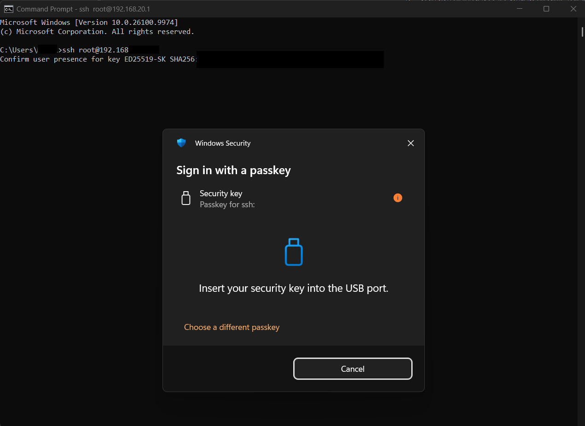
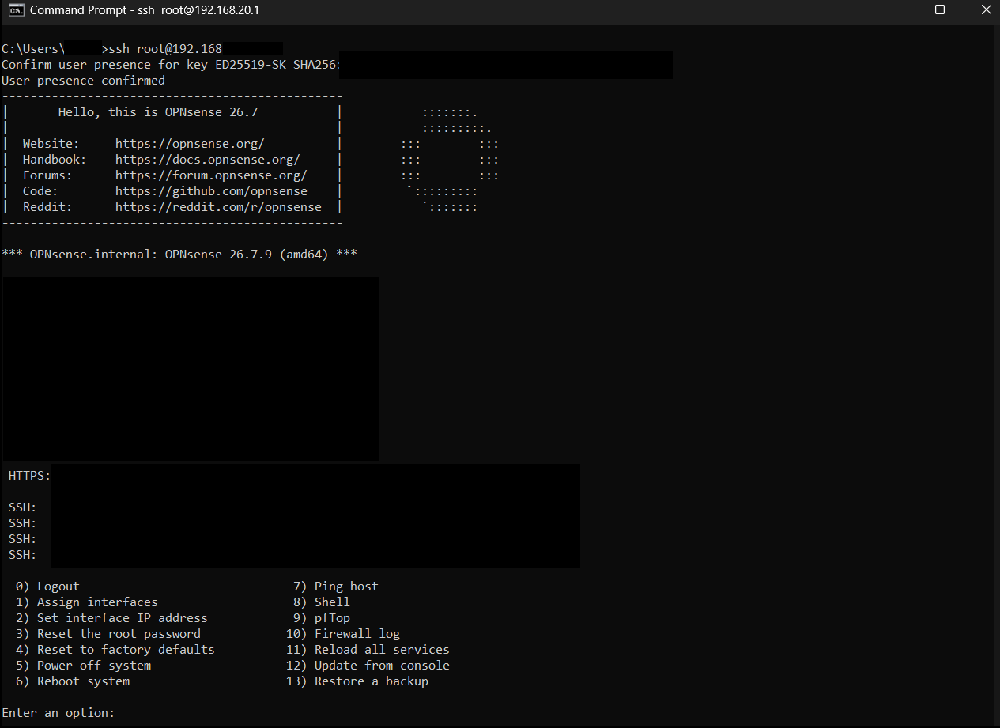
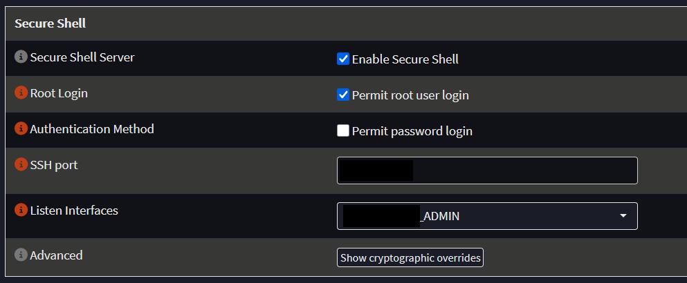

# 01 – Hardening admin access to OPNsense

## Why I looked at this

Before this, I didn't use SSH on the firewall at all. Everything was done in the web GUI.

That changed when a PHP vulnerability was being exploited all over the world. The OPNsense web GUI runs on PHP, and I installed the fix about a week late, maybe more. So I wanted to check whether anything had happened in that time: I went through the logs and checked whether anything had been planted on the system. I found no signs of a break-in.

For that I needed a shell, so I turned on SSH with root password login for a short time. That's not something I wanted to leave on, so after the check I moved SSH to a hardware key.

## What I set up

- SSH key stored on a YubiKey 5C NFC (`ed25519-sk` key type)
- Password login turned off, so only the key works
- SSH listens only on the ADMIN VLAN
- The web GUI is reachable only from the LAN and the ADMIN VLAN

Every login now needs the YubiKey plugged in and a touch. On Windows a ''Sign in with a passkey'' prompt pops up first:

After the touch, the login goes through:

## How the `-sk` key works

The first time I mostly followed the steps, so here is how it actually works:

- The key is generated with `ssh-keygen -t ed25519-sk`.
- The private key never leaves the YubiKey. The file saved on the PC (`id_ed25519_sk`) is only a handle that points to the key on the YubiKey. Copied to another computer, it's useless without the YubiKey itself.
- The public key (`id_ed25519_sk.pub`) is added to the root user in OPNsense (System → Access → Users→ root → Authorized keys).
- On every login the YubiKey has to confirm "user presence", which is the touch. Software on the PC can't use the key without me noticing.

## Settings

System → Settings → Administration → Secure Shell:

- Enable Secure Shell: on
- Permit root user login: on
- Permit password login: **off**
- Listen Interfaces: ADMIN only

## If I lose the YubiKey

The web GUI still uses a normal login and is reachable only from the LAN and the ADMIN VLAN. From there I can turn password login back on for a moment, or add a new key.

## What went wrong

The setup itself worked on the first try. The real mistake happened earlier: I installed the security fix about a week late. Nothing came of it this time, but updates on the firewall need a routine, not "when I remember". 

## Next steps

- Register a second YubiKey as a backup
- Require a PIN on the key as well as a touch (`ssh-keygen -O verify-required`)
- Use a separate admin user instead of root, then turn off root login
- Get notified about new OPNsense updates
- Write down the Proxmox console as the last-resort way in, since OPNsense runs as a VM
